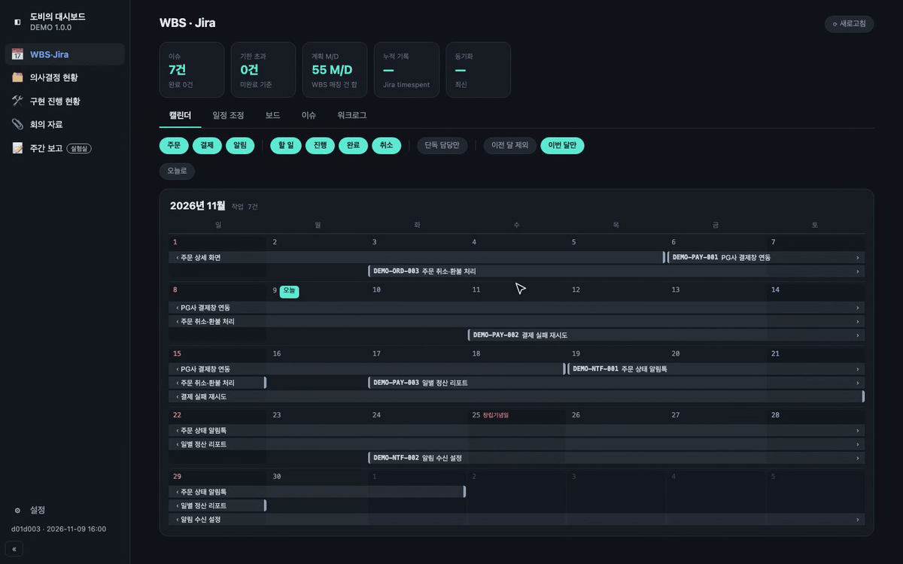
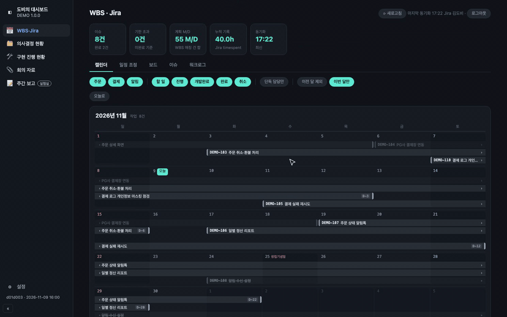
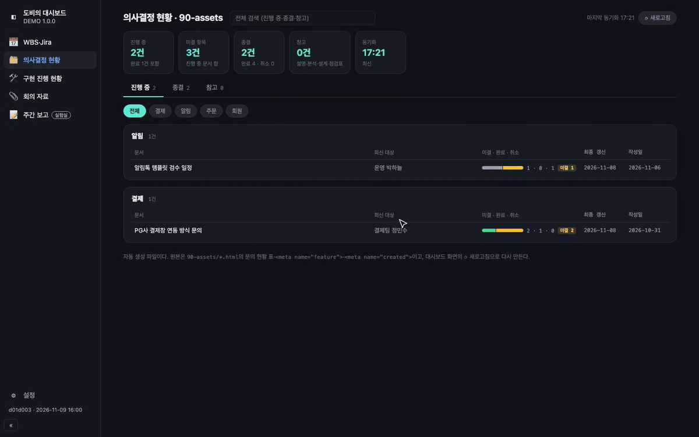
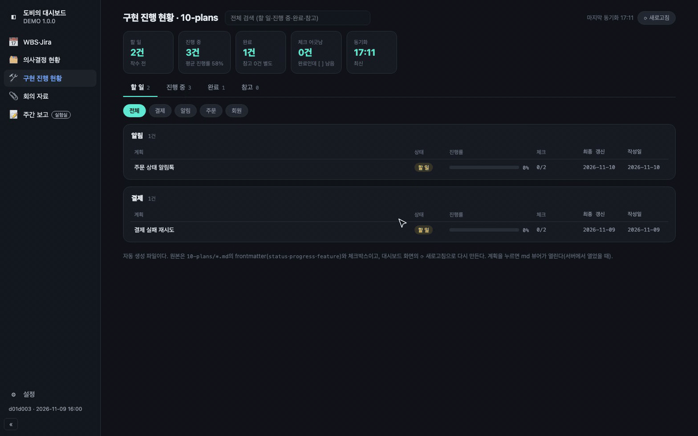
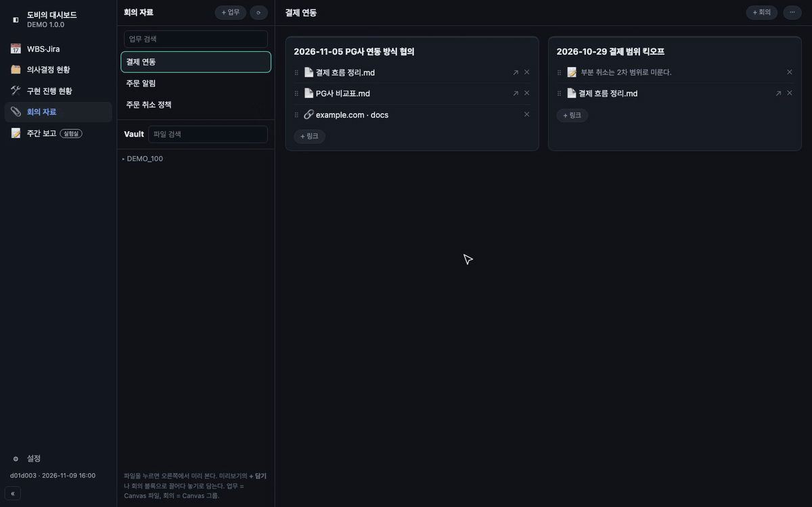
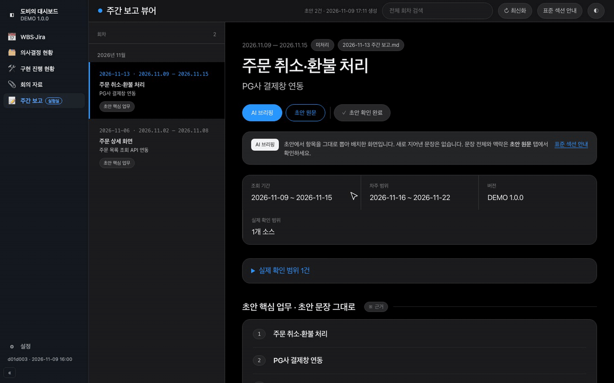

# dobbys-dashboard

업무 도구 여러 개를 한 화면 사이드바에 모은 로컬 대시보드다. 필요한 탭만 골라 켠다.

**한 번에 한 프로젝트만 본다.** 온보딩에서 프로젝트 이름(예: `TRB 4.0.0`)을 적고 그 프로젝트의 폴더·파일을 Finder에서 고른다. 지난 프로젝트 자료는 Obsidian에서 본다.

| id | 사이드바 이름 | 필요한 설정 | 로그인 위치 |
|---|---|---|---|
| `wbs` | 📅 WBS·Jira | 일정 기준(WBS 엑셀 / Jira), Jira 도메인·프로젝트 키. WBS 기준이면 WBS 엑셀 파일·담당자 이름(시트 이름은 기본값 있음) | 탭 안(Jira, WBS 기준이면 선택) |
| `assets` | 🗂️ 의사결정 현황 | 의사결정 문서 폴더 | 없음 |
| `plans` | 🛠️ 구현 진행 현황 | 구현 계획 폴더 | 없음 |
| `comments` | 💬 기획서 코멘트 현황 | 기획서(TROMBONE) 주소, 체크리스트 저장 폴더(선택) | 탭 안(TROMBONE) |
| `meetings` | 📎 회의 자료 | Vault 안 회의 폴더 | 없음 |
| `weekly` | 📝 주간 보고 (실험실) | 주간 보고 폴더(여러 개 가능) | 없음 |

## 화면

목업 데이터로 찍은 탭별 시연이다.

### 📅 WBS·Jira

WBS 엑셀만 쓸 때: 캘린더에서 기능 구분 칩으로 거르고 보드로 넘어간다. 보드 칸은 카드 아래 칸 선택으로 정한 값이다.



Jira에 로그인했을 때: WBS 행에 연결한 Jira 이슈의 일정·상태·기록 시간이 WBS보다 우선하고, WBS에 없는 내 담당 이슈도 함께 보인다. 보드 칸은 Jira 상태를 따른다. 일정 조정에서 막대를 끌어 기간을 옮기면 Jira에는 보내지 않고 변경안으로만 쌓인다. 워크로그에서 기간별 기록을 본다.



### 🗂️ 의사결정 현황

기능 구분으로 거르고 진행 중·종결 문서를 본다. 문서 이름을 누르면 그 문서가 열린다. 모든 상태(참고 포함)의 문서 이름 옆 **경로 복사**는 시스템 루트 기준 절대 경로를 클립보드에 복사한다.



### 🛠️ 구현 진행 현황

할 일·진행 중·완료 계획의 진행률과 체크 수를 본다. 모든 상태(참고 포함)의 계획 이름 옆 **경로 복사**로 원본 md의 절대 경로를 복사한다. 복사 결과는 버튼에 `복사됨`·`복사 실패`로 표시된다.



### 📎 회의 자료

회의 블록의 파일을 미리 보고 다른 업무로 옮긴다. Vault 파일을 검색해 회의 블록으로 끌어다 놓고, `+ 링크`로 웹 페이지 주소를 넣는다.



### 📝 주간 보고 (실험실)

AI 브리핑을 내려 보고 초안 원문으로 바꾼다.



## 요구 사항

- macOS
- Python 3.11 이상(`python3 --version`으로 확인한다). 표준 라이브러리만 쓴다.
- Obsidian Vault(회의 자료 탭)

## 설치

받을 저장소에 따라 명령이 다르다. 받은 저장소가 `origin`이 되므로, 이후 ⬆ 업데이트도 그 저장소에서 받는다.

### GitHub에서 받기

터미널에 한 줄을 붙여 넣는다.

```
curl -fsSL https://raw.githubusercontent.com/devseongeun/dobbys-dashboard/main/scripts/install.sh | sh
```

### 사내 scm에서 받기

사내망(VPN)에서 터미널에 한 줄을 붙여 넣는다. scm은 로그인이 필요해 스크립트를 바로 받을 수 없으므로, 먼저 `git clone`으로 받은 뒤 그 안의 설치 스크립트를 실행한다. clone 중에 scm 계정(사용자 이름·비밀번호 또는 토큰)을 묻는다.

```
git clone http://10.255.17.161:8190/scm/api/v0/git/okestro/dobbys-dashboard.git ~/workspace/dobbys-dashboard && sh ~/workspace/dobbys-dashboard/scripts/install.sh
```

git이 없으면 clone 대신 Command Line Tools 설치 창이 뜬다. 설치가 끝나면 같은 명령을 다시 붙여 넣는다. 이미 받아 둔 뒤 다시 설치하려면 `sh ~/workspace/dobbys-dashboard/scripts/install.sh`만 실행한다.

### 설치 스크립트가 하는 일

`scripts/install.sh`가 macOS·git(없으면 Command Line Tools 설치 창을 띄운다)·Python 3.11 이상(macOS 기본 `python3`는 3.9라 Homebrew·python.org 것을 찾는다)을 확인하고 `~/workspace/dobbys-dashboard`에 받는다(scm은 이미 받아 둔 것을 쓴다). 그다음 **항상 실행할지** 묻는다. 예(기본)면 [상주 실행](#상주-실행)으로 등록해 로그인 때 켜지고, 아니요면 지금 터미널에서 띄운다. 어느 쪽이든 브라우저가 열린다. 이미 받아 둔 곳에서 다시 실행하면 최신으로 받고 같은 질문을 한다. 설치 위치는 `DOBBYS_DIR`, 포트는 `PORT`, 질문의 답은 `DOBBYS_ALWAYS=y|n`으로 미리 정한다.

### 직접 받기

```
git clone https://github.com/devseongeun/dobbys-dashboard.git ~/workspace/dobbys-dashboard
cd ~/workspace/dobbys-dashboard && python3 serve.py
```

그다음 `http://127.0.0.1:8787/`을 열면 온보딩이 뜬다. 프로젝트 이름을 적은 뒤 "WBS와 Jira 일정을 한눈에 보고 관리하고 싶어요" 같은 질문에 하나씩 예·아니요로 답한다. 예라고 답한 탭만 켜지고, 그 탭의 경로·옵션은 같은 화면에서 바로 정한다. 경로는 직접 적지 않는다. **폴더 선택**·**파일 선택**·**폴더 추가**(여러 폴더 칸)를 누르면 서버가 Finder 선택 창(`osascript`, `dashboard/picker.py`)을 띄우고 고른 절대 경로를 채운다. 선택 창이 브라우저 뒤에 뜨면 Dock에서 찾는다. 마지막 확인 화면에서는 탭마다 토글로 켜고 끄고, 탭 이름을 누르면 그 자리에 입력 항목이 펼쳐진다(켜면 바로 펼쳐지고, 저장 오류가 난 탭도 펼쳐진다). 확인 화면에서 저장한다. 온보딩에서 적은 값은 저장한 뒤에도 바꿀 수 있다. ⚙ 설정은 확인 화면과 같은 탭 편집 화면(토글 + 아코디언, `shell/onboarding.js`의 `tabEditor`)에 프로젝트 이름 칸을 더한 것으로, 한 화면에서 프로젝트 이름, 탭 켜기·끄기, 경로를 고친다.

문서 안 형식에서 상태를 읽는 탭(의사결정 현황, 구현 진행 현황, 주간 보고)은 그 탭 질문에 예라고 답한 화면, 확인 화면, ⚙ 설정에서 **문서 템플릿**을 내려받는다. 템플릿을 설정한 폴더에 넣고 제목과 값만 고치면 탭이 경고 없이 읽는다. 파일명은 고정(`YYYY-MM-DD 계획 제목.md`처럼 날짜 자리는 직접 채운다)이고, 본문의 작성일·갱신일만 내려받는 날로 채워진다. 원본은 `tabs/<id>/templates/`다.

## 팀 공용 Claude Code 스킬

이 저장소는 Claude Code 플러그인 마켓이기도 하다(`.claude-plugin/`). Claude Code에서 한 번 설치하면 어느 폴더에서든 쓴다. GitHub 저장소 읽기 권한이 있어야 한다.

```
/plugin marketplace add devseongeun/dobbys-dashboard
/plugin install dobbys-dashboard@dobbys-dashboard
```

| 스킬 | 요청 예 | 하는 일 |
|---|---|---|
| `weekly-report-draft` (실험실) | "이번 주 주간 보고 초안 써줘" | 이번 주 내 커밋(`git config user.email`)과 Jira 이슈로 주간 보고 탭의 표준 섹션 형식(`tabs/weekly/templates/`) 초안을 쓴다. 업무 묶음을 확인받은 뒤 ⚙ 설정의 주간 보고 첫 폴더에 `YYYY-MM-DD 주간 보고.md`로 저장한다. |

새 버전은 이 저장소에 push하면 팀원이 `/plugin marketplace update dobbys-dashboard` 뒤 `/plugin update dobbys-dashboard@dobbys-dashboard`로 받는다. 스킬은 `skills/<이름>/SKILL.md`에 둔다.

## 상주 실행

`scripts/install-launchd.sh`를 실행하면 로그인 때 대시보드를 띄우고, 죽으면 다시 띄운다. 다시 실행하면 등록을 갈아끼운다. Python은 `PATH`의 `python3`를 쓰고, 다른 것을 쓰려면 `PYTHON=<경로>`로 준다(한 줄 설치는 찾은 3.11 이상을 넘긴다).

- 재시작: `launchctl kickstart -k gui/$(id -u)/com.dobbys-dashboard`
- 중지: `launchctl bootout gui/$(id -u)/com.dobbys-dashboard`
- 로그: `~/Library/Logs/dobbys-dashboard/`

서버 코드를 고친 뒤에는 재시작이 필요하다.

상주 실행 중에는 macOS 개인정보 보호(TCC) 때문에 Python이 `~/Downloads`·`~/Desktop`의 파일을 읽지 못하고, 권한 창을 기다리며 멈춘다(WBS 엑셀이 `~/Downloads`에 있으면 WBS 탭이 응답하지 않는다). WBS 엑셀과 설정한 폴더는 모두 `~/Downloads`·`~/Desktop` 밖(예: Vault 안)에 둔다. macOS가 "Python … 폴더의 파일에 접근하려고 합니다"를 띄우면 허용하거나, 파일을 옮기고 ⚙ 설정에서 경로를 고친 뒤 `launchctl kickstart -k gui/$(id -u)/com.dobbys-dashboard`로 재시작한다.

## 업데이트

사이드바 맨 아래에 현재 커밋(`10ac8f8 · 2026-11-06`)이 보인다. 서버가 열 때와 30분마다 `origin`을 받아 비교하고, 새 커밋이 있으면 그 위에 **⬆ 업데이트 N건**이 뜬다(마우스를 올리면 커밋 제목). 누르면 `git pull --ff-only` 뒤 서버가 같은 자리에서 다시 떠서 화면이 새로고침된다. launchd 상주든 터미널에서 `python3 serve.py`로 띄웠든 같다.

- 자동 업데이트를 거절하는 경우: 커밋하지 않은 로컬 변경이 있거나, 로컬 커밋이 `origin`보다 앞서 있을 때. 링크가 붉게 바뀌고 이유를 보여 준다. 정리한 뒤 다시 누른다.
- `git clone`이 아니라 압축으로 받았으면 git 저장소가 아니라 표시 자체가 없다.
- 터미널에서: `scripts/update.sh`. 같은 일을 하고, launchd 등록이 있으면 재시작까지 한다.

## 프로젝트 바꾸기

버전이 올라가거나 다른 프로젝트를 맡으면 ⚙ 설정에서 프로젝트 이름과 경로(WBS 엑셀, 폴더들, Jira 프로젝트 키, 기획서 주소)를 고치고 저장한다. 저장하면 탭을 다시 띄우므로 재시작은 필요 없다.

개인 상태(WBS↔Jira 수동 연결, 일정 조정 초안, 코멘트 우선순위·보류, 주간 보고 확인)는 프로젝트 이름 아래에 따로 저장된다. 이름을 바꾸면 빈 상태에서 시작하고, 이전 이름으로 돌아오면 그대로 복원된다. WBS ID나 코멘트 id가 프로젝트마다 다시 매겨져도 섞이지 않는다.

## 설정·데이터 위치

| 종류 | 위치 |
|---|---|
| 설정 | `~/.config/dobbys-dashboard/config.json` (0600) |
| 개인 상태 | `~/Library/Application Support/dobbys-dashboard/<프로젝트>/<tab>/` |
| 캐시 | `~/Library/Caches/dobbys-dashboard/` |
| 비밀값 | 키체인 `dobbys-dashboard.jira`·`dobbys-dashboard.trombone` (계정 `default`) |

설정을 초기화하려면 `config.json`을 지우고 서버를 재시작한 뒤(상주 실행이면 `launchctl kickstart -k gui/$(id -u)/com.dobbys-dashboard`, 직접 띄웠으면 Ctrl+C 후 `python3 serve.py`) 새로고침한다. 서버는 설정을 시작할 때 한 번만 읽는다.

프로젝트 이름이 없는 옛 `config.json`은 온보딩(값은 미리 채워짐)으로 보내고, 옛 `Application Support/dobbys-dashboard/<tab>/`은 처음 이름을 저장할 때 그 이름 아래로 옮긴다.

## 탭별 메모

- **WBS**: 일정 기준을 고른다. **WBS 엑셀 기준**은 엑셀의 내 행이 기본이고 Jira는 선택이다. 수동 연결이 먼저고, WBS 제목이 정확히 한 Jira 이슈와만 맞을 때만 자동으로 잇는다. **Jira 기준**은 엑셀 없이 탭 안에서 Jira에 로그인해 내 담당 이슈만 본다(엑셀 칸은 숨고 저장하지 않는다). 기준이 없는 옛 config는 WBS 엑셀 기준이다. API token은 `https://id.atlassian.com/manage-profile/security/api-tokens`에서 만든다.
  - 보드 칸은 할 일 → 진행 → 개발완료 → 완료 | 취소 | 기타 순이다. Jira 상태가 앞의 다섯이면 그 칸에, 아니면(Jira 미연결 포함) 기타 칸에 놓는다. Jira 상태가 다섯이 아닌 카드는 카드 아래 칸 선택으로 보드 칸과 상태 필터를 정할 수 있고, 개인 상태의 `wbs/status-assign.json`에 저장된다. Jira에는 보내지 않는다. Jira 상태가 다섯 중 하나로 바뀌면 Jira 값이 우선한다.
- **의사결정 현황**: 폴더 이름은 자유다(예: `90-assets`). 폴더 바로 아래 HTML 하나가 문서 한 건이고, 메타데이터는 문서 안에서 읽는다. 템플릿: `tabs/assets/templates/`.
  - 기능 구분·작성일: `<head>`의 `<meta name="feature" content="DB 설계, 배포">`·`<meta name="created" content="2026-09-17">`. 없으면 경고하고 `-`로 둔다.
  - 상태: 상단 문의 현황 표 `<section class="docst" data-doc="open|closed">`와 그 안의 `회신 대상<b>…</b>`·`집계<b>미결 n · 완료 n · 취소됨 n</b>`·`최종 갱신<b>YYYY-MM-DD</b>`. 표가 없으면 참고 문서다.
  - 화면 이름: 파일명에서 `프로젝트_버전_` 접두어(예: `TRB_4.0.0_`)와 끝의 `_v1.0`을 떼고 밑줄을 공백으로 바꾼다.
  - 목록 `00_<폴더명>_목록.md`·`.html`은 자동 생성이고 `00_`으로 시작하는 파일은 목록에서 뺀다.
- **구현 진행 현황**: 폴더 이름은 자유다(예: `10-plans`). 폴더 바로 아래 `YYYY-MM-DD 제목.md` 하나가 계획 한 건이고, 하위 폴더는 보지 않는다. 템플릿: `tabs/plans/templates/`.
  - frontmatter 한 줄짜리 키만 읽는다: `status`(할 일·진행 중·완료, 없으면 참고), `progress`(0–100), `feature`(`A, B` 또는 `[A, B]`, 없으면 미분류), `updated`·`created`(최종 갱신).
  - 체크는 펜스 코드 블록 밖의 `- [ ]`·`- [x]`를 센다. 완료인데 `[ ]`가 남으면 ⚠.
  - 목록 `00_<폴더명>_목록.md`·`.html`은 자동 생성이다.
- **기능 구분 표에서 옮기기**: 예전 `00_<폴더명>_기능구분.md` 표를 쓰던 폴더는 `python3 scripts/migrate-features.py --assets <폴더> --plans <폴더> [--dry-run]`으로 각 문서 안에 meta·`feature`를 넣고 표를 지운다.
- **코멘트**: 사내망(VPN)이 필요하다. 👀는 토글이라 직전 상태를 확인하고 보낸다.
- **회의 자료**: 대시보드에서 편집할 때는 Obsidian에서 같은 Canvas를 닫는다.
  - 업무 > 회의 > 자료 구조다. 회의 폴더의 Canvas 파일 하나가 **업무** 하나(예: `외부 연계, 외부 결재.canvas`), 그 Canvas의 그룹 하나가 그 업무의 **회의** 블록 하나(예: `2026-11-03 인프라 업무 협조 요청`)다. 회의 블록은 이름 앞 `YYYY-MM-DD` 날짜 최신순이고, 날짜가 없는 그룹은 그 뒤에 Canvas 위치순, 어느 그룹에도 들어가지 않은 카드는 맨 뒤 `미분류`에 모인다.
  - 대시보드에서 `+ 업무`(이름만)·`+ 회의`(날짜·이름 → `YYYY-MM-DD 이름`)로 만들고, 업무·회의 이름을 눌러 바꾸고, 왼쪽 Vault 트리(검색 가능)의 파일을 회의 블록으로 끌어다 놓아 담고, 블록의 `+ 링크`로 OneDrive 같은 웹 페이지를 넣는다. 카드는 ⠿로 끌어 블록 안 순서를 바꾸거나 다른 회의로 옮기고, ✕로 회의에서 뺀다(파일은 지우지 않는다). 블록 안 순서는 회의 폴더의 `.order/<업무 id>.json`에만 저장되고 Canvas 배치는 그대로다. 다른 회의로 옮기거나 새로 넣은 카드는 그 그룹 맨 아래에 놓이고, 그룹이 모자라면 늘어나며 그 아래 카드가 밀린다. 새 회의 그룹은 Canvas 맨 아래에 생긴다. Obsidian Canvas에서 직접 고쳐도 된다. 자료 조사 메모는 Obsidian Canvas에서 텍스트 카드로 넣는다. Obsidian에서 고친 뒤에는 ⟳로 다시 읽는다. 열린 Canvas를 Obsidian이 저장하면 대시보드 변경을 덮어쓸 수 있다. 그사이 Canvas가 바뀌었으면 저장하지 않고 다시 불러온다. 대시보드에서 업무 이름을 바꾸면 다른 노트의 그 Canvas 링크는 고쳐지지 않는다. md는 대시보드 안에서 렌더, html·PDF·이미지는 iframe으로 보여 주고, 그 밖의 형식과 원본은 `Obsidian에서 열기`로 연다.
  - 관리: 목록 위 검색 칸은 업무 이름·날짜로 거른다(낱말을 띄우면 모두 들어간 업무만). 목록 항목에 마우스를 올리면 ✎ 이름 바꾸기·🗑 삭제가, 보고 있는 업무는 제목 옆 `⋯` 메뉴에 업무 이름 바꾸기·Obsidian에서 열기·업무 삭제가 있다. `+ 업무`로 만들면 그 업무로 옮기고 `+ 회의` 칸을 바로 연다. 회의 이름 옆 ✕는 회의 블록(Canvas 그룹)만 지우고 안의 카드는 바깥 블록이나 `미분류`로 남긴다.
  - 업무 삭제는 Canvas와 순서 파일을 회의 폴더의 `.trash/<지운 시각>/`(`<업무 id>.canvas`, `.order/<업무 id>.json`)으로 옮긴다. 담긴 Vault 파일은 지우지 않는다. 되살리려면 그 폴더 안의 것을 회의 폴더로 다시 옮긴다. JSON이 깨진 Canvas도 지울 수 있다. `.trash/`는 숨김 폴더라 목록·Vault 트리·Obsidian에는 보이지 않지만 Vault git에는 남으니 필요 없으면 직접 비운다.
  - 예전 `YYYY-MM-DD 이름.canvas` 파일도 그대로 업무로 읽힌다(목록에 날짜가 함께 보인다). 업무 이름 바꾸기 칸에서 앞 날짜를 지우면 된다. 날짜 없이 `11/3 ①`처럼 적은 그룹은 날짜 정렬에서 뒤로 간다.
- **주간 보고 (실험실)**: 실험 중인 탭이라 형식·화면이 바뀔 수 있다. 폴더 여러 개를 쓸 수 있다. AI 브리핑은 초안의 표준 섹션(보고 기간·이번 주 핵심 업무·업무별 상세 내용·정량 지표·금주/차주 주요 사항·이슈 및 기타 사항·PPT 붙여넣기용·출처 및 검증·PPT 처리)을 찾아 배치한다. 섹션별 쓰는 법은 뷰어의 `표준 섹션 안내`에서 보고, 템플릿은 그 창이나 온보딩·⚙ 설정에서 내려받는다: `tabs/weekly/templates/`. Claude Code를 쓰면 [팀 공용 스킬](#팀-공용-claude-code-스킬) `weekly-report-draft`가 같은 형식으로 초안을 쓴다.

## 웹 버전(사내 서버용)

로컬판(`serve.py`, launchd)과 따로 도는 브라우저용 판이다. 사내 공용 서버에 올려 팀원이 설치 없이 쓴다. 로그인은 없다. 1단계 탭은 WBS·Jira(wbs)와 구현 진행 현황(plans)이고, 2단계에서 주간 보고(weekly, 실험실)를 더했다.

- **파일은 서버로 가지 않는다.** 브라우저가 File System Access API 로 고른 폴더·파일을 직접 읽는다. 서버(`web_serve.py`)는 정적 화면(`web/`)과 `/api/<이름>` 프록시만 준다.
- **Chrome·Edge 전용.** Firefox·Safari 는 폴더 선택을 지원하지 않아 첫 화면에 안내만 뜬다.
- **HTTPS 가 필요하다.** 브라우저는 보안 출처에서만 폴더 선택 창을 연다. `http://localhost`·`http://127.0.0.1` 은 예외라 내 PC 에서 띄워 볼 때는 HTTP 로 된다.
- **로컬판과 따로 저장된다.** 설정·순서·탭 상태는 브라우저 IndexedDB(`dobbys-dashboard`), 비밀값(Jira token)은 브라우저 sessionStorage(‘이 브라우저에 기억’이면 localStorage)에 둔다. `~/.config/dobbys-dashboard/`·키체인과 섞이지 않고, 브라우저·프로필·주소(출처)마다 따로다. 다른 브라우저로 옮기려면 ⚙ 설정의 **설정 내보내기(JSON)** → **설정 가져오기**를 쓴다. 폴더·파일 선택과 비밀값은 옮겨지지 않아 가져온 뒤 다시 고른다.
- 폴더 권한은 브라우저가 방문 때마다 다시 물을 수 있다. 그러면 위에 뜨는 **폴더 다시 연결**을 누른다.
- **WBS·Jira 탭**: WBS 엑셀(.xlsx)은 브라우저가 직접 읽고 서버로 보내지 않는다. 권한이 풀리면 탭 위 **WBS 엑셀 다시 연결**을 누른다. 수동 연결·보드 칸 지정·일정 초안은 IndexedDB 에 남는다. Jira 로그인(이메일·API token)은 탭 안에서 하고 브라우저에만 둔다(기본은 창을 닫으면 사라지고, **이 브라우저에 기억**을 켜면 localStorage).
- **Jira 프록시(`/api/jira`)**: Atlassian 이 API token 방식의 브라우저 직접 호출(CORS)을 받지 않아 서버가 전달만 한다. `https://<사이트><JIRA_HOST_SUFFIX>` 의 `GET /rest/api/3/myself`·`/rest/api/3/search/jql`·`/rest/api/3/issue/<KEY>/worklog` 만, 경로마다 정해진 쿼리와 로컬판이 만드는 JQL 모양만 통과한다. `Authorization` 은 받은 그대로 한 번 넘기고 저장·로그하지 않으며 오류 응답에도 싣지 않는다. 리다이렉트를 따라가지 않고 30초 안에 답이 없으면 504 다.
- **주간 보고 탭**(실험실): ⚙ 설정의 **폴더 추가**로 고른 초안 폴더 여러 개를 브라우저가 직접 읽어 로컬판과 같은 뷰어(회차 목록·AI 브리핑·초안 원문)를 화면에서 만든다. 뷰어 HTML·`sources.json` 을 쓰지 않고 서버 재생성도 없다. ↻ 최신화는 폴더를 다시 읽는다. **초안 확인 완료** 표시는 IndexedDB(탭 상태 `reviewed`, 로컬판 `reviewed.json` 과 같은 `{회차: 시각}` 모양)에 남는다. 폴더 경로를 모르므로 같은 주 초안 고르기·같은 날짜 회차 순서는 (폴더 이름, 파일 이름) 순을 쓴다(같은 상위 폴더 아래 폴더면 로컬판과 같다).
- 경로 칸에는 고른 폴더·파일 이름만 보인다(브라우저는 절대 경로를 모른다). 계획 이름 옆 **경로 복사**를 쓰려면 ⚙ 설정의 '실제 경로(경로 복사용, 선택)' 칸에 이 PC 에서의 폴더 경로를 적는다. PC·브라우저마다 다시 적는다.
- ⬆ 업데이트·Finder 선택 창·키체인은 없다. 사이드바 아래 버전 줄은 서버 체크아웃의 커밋(`api/version`, 환경변수 `DOBBYS_COMMIT`·`DOBBYS_COMMIT_DATE` 가 있으면 그 값)이다. 서버 갱신은 운영자가 pull 뒤 재시작한다.

실행:

```
python3 web_serve.py                       # http://127.0.0.1:8788/
PORT=8790 python3 web_serve.py
HOST=127.0.0.1 PORT=8788 ALLOWED_ORIGINS=https://dash.example.com python3 web_serve.py
```

| 환경변수 | 기본값 | 뜻 |
|---|---|---|
| `HOST` | `127.0.0.1` | 바인딩 주소. 리버스 프록시 뒤에서는 그대로 둔다. |
| `PORT` | `8788` | 포트. |
| `JIRA_HOST_SUFFIX` | `.atlassian.net` | `/api/jira` 가 받는 Jira 주소 끝. `<사이트>` 는 영문 소문자·숫자·`-` 한 단어다. |
| `ALLOWED_ORIGINS` | `http://127.0.0.1:<PORT>,http://localhost:<PORT>` | 쉼표 구분 origin. 요청 `Host` 는 이 중 하나의 host[:port] 여야 하고(아니면 421), `/api/*` 의 `Origin` 은 이 중 하나와 같아야 한다(아니면 403). |

사내 서버에서는 HTTPS 리버스 프록시(nginx 등) 뒤에 둔다. 프록시는 원래 `Host` 를 포트까지 넘기고(nginx `proxy_set_header Host $http_host;`. `$host` 는 포트를 떼어 443 이 아닌 포트에서 421 이 된다), `ALLOWED_ORIGINS` 에 사용자가 여는 주소(예: `https://dash.example.com`)를 적는다. 하위 경로(`/dashboard/`)에 올려도 화면은 상대 경로만 쓰므로 그대로 동작한다. 이때 프록시가 접두어를 떼고 넘긴다.

**Docker**: `deploy/` 의 compose 가 nginx(자체 서명 인증서로 HTTPS) + `web_serve.py` 두 컨테이너를 띄운다. `cd deploy && cp .env.example .env && docker compose up -d --build` 뒤 `https://localhost:9443`. 자세한 것은 [deploy/README.md](deploy/README.md).

서버가 하는 검사: `web/` 밖 경로·숨김 파일 거절(웹이 함께 쓰는 로컬판 파일은 `web_serve.py` 의 `SHARED_FILES` 목록만), 모든 응답에 `Content-Security-Policy`(스크립트는 같은 출처만)·`X-Content-Type-Options: nosniff`·`Referrer-Policy: no-referrer`, `/api/*` 는 `X-Dobbys-Proxy: 1` 헤더 필수·본문 64 KiB 까지. 로그에는 메서드·경로·상태만 남고 쿼리·헤더는 남지 않는다.

웹 쪽 코드: `web_serve.py`, `api/`(프록시, `api/<이름>.py` 의 `handle(Request) -> Response`), `web/`(셸 `web/shell/`, 브라우저 모듈 `web/lib/`, 탭 목록 `web/tabs/manifest.js`, 탭 화면 `web/tabs/<id>/`). 주간 보고 화면은 `web/tabs/weekly/`(로컬판 `report_parser.py`·`markdown_renderer.py`·`generate_viewer.py` 를 옮긴 `report_parser.js`·`markdown_renderer.js`·`viewer_html.js`, 화면 `weekly.js`, 로컬판 CSS 를 그대로 옮긴 `weekly.css`). 테스트는 `tests/test_web_serve.py`, `tests/test_web_jira_proxy.py`, `tests/js/web/`(`weekly_*.test.js` 는 같은 초안 폴더 여러 개로 로컬판과 결과 비교), `tests/js/wbs_web/`(같은 예제 엑셀·Jira 응답으로 로컬판과 결과 비교).

## 보안

- `127.0.0.1`(과 `::1`)에만 바인딩한다.
- 모든 경로에서 Host 헤더를 검사한다(`127.0.0.1`, `localhost`, `::1`).
- 쓰기 요청은 `Content-Type: application/json`만 받는다.
- 비밀값은 키체인에만 둔다.

## 개발

```
python3 -m unittest discover -s tests -t . -v
bun test tests/js
```

최초 온보딩을 다시 보려면 `sh scripts/sandbox.sh`(기본 포트 8790, `PORT=…`로 변경)를 실행하고 `http://127.0.0.1:8790/`을 연다. 임시 `HOME`에서 빈 설정으로 뜨므로 실제 설정·상태는 그대로고, 끄면 임시 폴더를 지운다. Finder 선택 창은 실제 디스크를 보여 주므로 고른 경로도 실제 폴더다. 키체인은 실제 것을 쓰므로 샌드박스 탭 안에서는 로그인하지 않는다.

README [화면](#화면)의 GIF(`docs/demo/<장면>.gif`)는 `sh scripts/demo/record.sh`로 다시 찍는다. `scripts/demo/mock_data.py`가 임시 `HOME`에 가짜 Vault(WBS 엑셀·의사결정 HTML·계획 md·회의 Canvas·주간 보고 md), 설정, Jira 목업 응답(`demo-jira.json`)을 오늘 날짜 기준으로 만든다. `scripts/demo/serve_demo.py`는 `serve.py`와 같되 키체인을 메모리로, Jira HTTP를 그 목업 응답으로 바꿔 띄우므로 실제 키체인·Jira에 닿지 않고 아무 이메일·token으로 로그인된다. 비어 있는 포트에 띄운 이 서버를 `scripts/demo/record.mjs`(Playwright, 임시 폴더에 설치)가 다크 모드로 영상 하나에 녹화하면서 장면 구간을 남기고, ffmpeg가 구간마다 GIF를 하나씩 자른다. 서버가 목업 프로젝트(`DEMO 1.0.0`)가 아니면 녹화하지 않는다. node(npm)와 ffmpeg가 필요하다. 장면은 `record.mjs`, 데이터는 `mock_data.py`에서 고친다.

탭을 추가하려면 `tabs/<id>/__init__.py`에서 `TAB`을 내보내고, `tabs/__init__.py`의 `ALL_TABS`에 넣는다. 첫 온보딩에서 물을 불편 지점은 `Tab(question=…, summary=…)`에 적는다(비면 "탭을 쓸까요?"로 묻는다). 문서 형식이 정해진 탭은 `Tab(templates=(Template(경로, help=…),))`로 템플릿을 붙이면 질문·확인 화면과 ⚙ 설정에 내려받기 링크가 뜬다(`/_dashboard/templates/<id>/<순번>`, 파일명은 그대로, 본문의 `{{TODAY}}`는 오늘 날짜). 실험 중인 탭은 `Tab(experimental=True)`로 두면 사이드바와 탭 편집 화면(확인 화면·⚙ 설정)의 이름 옆에 `실험실`이 붙는다.
